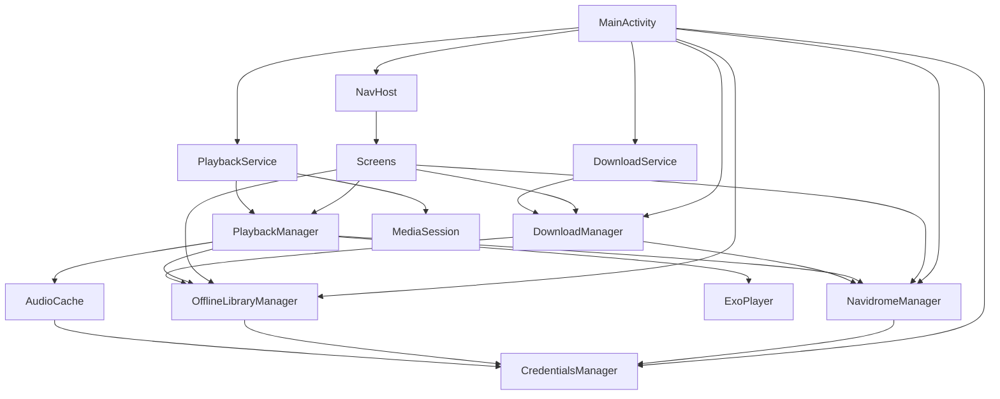

# VVAD Player — Architecture and Feature Reference

> Status: current implementation notes, with known gaps called out.
> Related document: [WORK_PLAN.md](WORK_PLAN.md) for planned fixes and features.

## 1. Project overview

VVAD Player is a native Android client for a Navidrome music server.

| Item | Value |
|---|---|
| Language | Kotlin |
| UI | Jetpack Compose + Material 3 |
| Audio | AndroidX Media3 / ExoPlayer 1.3.1 |
| Images | Coil 2.5.0 |
| Settings persistence | DataStore Preferences |
| Offline metadata | JSON files in app-private storage |
| Streaming cache | Media3 `SimpleCache` |
| Min SDK | 26 |
| Compile / target SDK | 34 |
| Gradle | 8.2 |
| Android Gradle Plugin | 8.0.2 |
| Kotlin | 1.9.24 |
| Compose BOM | 2024.06.00 |
| Module layout | Single `:app` module |
| Package | `com.vvad.vp` |

The app follows a direct-manager architecture rather than MVVM with ViewModels or a DI framework. Compose screens receive manager instances and hoist UI state locally.

## 2. High-level architecture



### Layer responsibilities

- **UI layer** — Compose screens and reusable components. Screens call managers directly and keep screen-local state with `remember`/`mutableStateOf`.
- **Playback layer** — `PlaybackManager` owns ExoPlayer, the queue, current track metadata, favorites, progress, and scrobbling. `PlaybackService` exposes playback through a MediaSession and foreground notification.
- **Data layer** — `NavidromeManager` handles server API access; `OfflineLibraryManager` handles downloaded files and metadata; `AudioCache` handles streaming cache; `CredentialsManager` persists connection and quality settings.
- **Download layer** — `DownloadManager` runs a serial in-memory download queue; `DownloadService` shows foreground notification progress.

## 3. Startup and dependency wiring

`MainActivity.onCreate()` (`MainActivity.kt:84`) does the following:

1. Creates `CredentialsManager`, `OfflineLibraryManager`, and `NavidromeManager`.
2. Initializes the `DownloadManager` singleton with those managers.
3. Starts and binds `PlaybackService`.
4. Gets the service-owned `PlaybackManager` through `PlaybackService.LocalBinder`.
5. Builds the Compose UI.

`PlaybackService.onCreate()` creates its own `CredentialsManager`, `OfflineLibraryManager`, `NavidromeManager`, and `PlaybackManager`, then creates the `MediaSession`.

> Important: the activity and playback service each create separate manager instances. They share the same DataStore and files, but they have separate in-memory state, including separate native API JWT tokens.

## 4. Navigation and screen structure

Routes are defined in `MainActivity.kt`:

| Route | Screen | Notes |
|---|---|---|
| `home` | `HomeScreen` | Start destination; only route with the top app bar |
| `search` | `SearchScreen` | Debounced library search |
| `albums` | `AlbumsScreen` | Sortable list/grid of albums |
| `artists` | `ArtistsScreen` | Sortable list/grid of artists |
| `album/{albumId}` | `AlbumScreen` | Album detail, download controls, track list |
| `artist/{artistId}` | `ArtistScreen` | Artist discography with tabs |
| `queue` | `QueueScreen` | Current playback queue |
| `settings` | `SettingsScreen` | Connection, transcoding, covers, cache |
| `cached-albums` | `CachedAlbumsScreen` | Manage downloaded/cached albums |

The full-screen `PlayerScreen` is not a navigation route. It is an `AnimatedVisibility` overlay controlled by `isPlayerVisible` in `MainActivity`.

### Bottom bar and safe padding

The bottom bar contains:

1. `PlayerStripe`, shown whenever a current track exists.
2. The main `NavigationBar` with Home, Search, Albums, and Artists.

The top bar height and bottom bar height are measured with `onSizeChanged`. Screens receive `topContentPadding` and `bottomContentPadding` so content can scroll behind the translucent bars.

### Screens

#### HomeScreen (`ui/screens/HomeScreen.kt`)

- Polls the server and offline library every 60 seconds when online and every 15 seconds when offline.
- Shows online sections: Available Offline, Random Albums, Recently Played, Most Played Albums, Most Played Artists.
- Falls back to cached albums when the network is unavailable or the server is unreachable.
- Uses a network callback to react to connectivity changes.
- Album and artist tiles use Coil and show a pulsing placeholder while covers load.

#### SearchScreen (`ui/screens/LibraryScreens.kt`)

- Searches albums, artists, and songs after a 300 ms debounce.
- Artist results are ordered as: top played non-comma artists, remaining non-comma artists alphabetically, then comma-containing artists.
- Song results navigate to the song's album rather than starting playback directly.
- Recent searches are persisted globally in the `search_prefs` `SharedPreferences` file: newest first, deduplicated case-insensitively, capped at 10.
- History is recorded only on keyboard search submit or when a result is opened, not on debounced keystrokes.
- Blank-query view shows recent searches with tap-to-search, per-entry removal, and clear-all.

#### AlbumsScreen / ArtistsScreen (`ui/screens/LibraryScreens.kt`)

- Server-side sorting by name, recently played, most played, release year, recently added, song count, duration, or artist album count.
- Ascending/descending toggle.
- List/grid toggle.
- Preferences are stored in the `library_prefs` `SharedPreferences` file.
- Album and artist rows/tiles open the corresponding detail screen.

#### Album cards (`ui/components/AlbumCardGestures.kt`)

- Shared gesture modifier used by Home, Albums, Artist, Search, and Cached Albums.
- Single tap opens the album.
- Double tap fetches the album's tracks and queues the whole album next.
- Long press fetches the album's tracks and appends the whole album to the queue.
- Both queue gestures give haptic feedback.
- Album detail itself intentionally has no album-level queue menu.

#### AlbumScreen (`ui/screens/AlbumScreen.kt`)

- Loads the cached album first, then refreshes from the server when online.
- Shows album cover, title, artists, year, and offline/cache availability.
- Download control supports:
  - Click to download.
  - Long-press or fully-cached click to open a menu.
  - Recache.
  - Delete cached files.
- Tracks are grouped by normalized `Track.discNumber` (missing/zero becomes 1) and sorted by disc, then track number.
- Multi-disc albums show `Disc X of N` headers; single-disc albums show no header.
- Display order and the flat playback/queue list use the same sorted list.
- Track rows use stable `pointerInput(track.id)` + `detectTapGestures` so recomposition does not break double taps:
  - Single tap: play track / toggle current track.
  - Double tap: queue next (with haptic feedback).
  - Long press: append to queue (with haptic feedback).
  - Favorite toggle.
- Album detail has no album-level queue menu; queue actions live on album cards elsewhere.
- Long multiline album titles are center-aligned.
- When offline, uncached tracks are disabled.

#### ArtistScreen (`ui/screens/ArtistScreen.kt`)

- Shows artist cover and name.
- Tabs: Albums, Singles & EPs, Featured In.
- Single detection uses `songCount == 1`, album type, and album-name keywords.
- Albums with missing or zero `songCount` are not classified as singles by count alone.
- Album tiles show a one-line marquee title.

#### QueueScreen (`ui/screens/QueueScreen.kt`)

- Displays the current queue with the playing item highlighted.
- Each row has a stable `queueId` key so duplicate tracks remain distinct.
- Non-current rows have an explicit delete button; the current row is protected.
- Long-press drag handle reorders items, with edge auto-scroll and haptic feedback.
- Reordered rows keep the ExoPlayer queue in sync through `PlaybackManager`.
- Clear-queue action keeps only the current track.

#### PlayerScreen (`ui/screens/PlayerScreen.kt`)

- Full-screen overlay over the main app.
- Blurred cover background with dark overlay.
- Album name and artist names are clickable.
- Favorite and queue buttons.
- Seek slider with buffered-progress indicator.
- Previous / play-pause / next controls.
- Back button and system back close the player.
- Swipe down past a 120 dp threshold closes the player; shorter drags spring back.
- Horizontal slider gestures are not affected.

#### PlayerStripe (`ui/components/PlayerStripe.kt`)

- Compact now-playing bar above the bottom navigation.
- Shows cover, title, album name, play/pause button, and a 3 dp progress line.
- Tapping opens `PlayerScreen`.
- Horizontal swipe on the track-info area skips tracks: left = next, right = previous.
- A 72 dp threshold prevents accidental skips; small drags snap back.
- Play/pause keeps its own gesture area, and skipping is disabled for single-item queues.

#### SettingsScreen (`ui/screens/SettingsScreen.kt`)

- Top-level category list opens submenus: Connection, Transcoding, Image Quality, Cache, System.
- Submenus use the in-screen back arrow and system back to return to the category list.
- Connection test and credential save.
- Transcoding format and max bitrate.
- Small/large cover art sizes.
- Navigate to cached albums.
- Clear all cached tracks.
- System submenu controls vibration feedback on/off, Light/Medium/Strong intensity, and a test action.
- Vibration settings are exposed through `LocalAppHaptics` in `ui/components/AppHaptics.kt`; all app haptics respect them.

#### CachedAlbumsScreen (`ui/screens/CachedAlbumsScreen.kt`)

- Lists downloaded/cached albums.
- Shows cached track count versus album song count.
- Supports recache and remove-from-cache.
- Shows download state from `DownloadManager.queueState`.

## 5. Playback subsystem

### PlaybackManager (`data/PlaybackManager.kt`)

`PlaybackManager` is the central playback controller.

#### ExoPlayer configuration

- Audio usage: media, content type: music.
- Load control: 30 s minimum buffer, 50 s maximum buffer, 2.5 s playback buffer, 5 s rebuffer buffer.
- Back buffer: 10 minutes, retained.
- Progressive media source factory.
- Audio offload disabled.
- Custom data source factory:
  - `file` / `content` URIs use `FileDataSource`.
  - Other URIs use the streaming `CacheDataSource`.

#### Observable state

| Field | Meaning |
|---|---|
| `queue` | List of `QueueEntry` objects |
| `currentQueueIndex` | Current index in the Compose queue |
| `currentTrack` | Currently playing `Track` |
| `currentAlbumId` | Album ID for the current track |
| `currentAlbumName` | Album name for the player UI |
| `currentCoverArtUrl` | Cover URL for the current track |
| `isPlaying` | Play/pause state |
| `currentPosition` | Current playback position in ms |
| `bufferedPosition` | Buffered position in ms |
| `duration` | Resolved duration in ms |
| `isCurrentTrackFavorite` | Favorite state for PlayerScreen |

`QueueEntry` contains:

```kotlin
data class QueueEntry(
    val track: Track,
    val albumId: String,
    val albumName: String,
    val coverArtUrl: String,
    val queueId: String = UUID.randomUUID().toString()
)
```

#### Media item construction

`buildMediaItem(entry)` prefers an offline file:

1. `OfflineLibraryManager.getLocalTrackFile(track.id)`.
2. If found, use a file URI and infer MIME type from the extension.
3. Otherwise, request a stream URL from `NavidromeManager.getStreamUrl(track.id)`.
4. Set MIME type from the preferred format.
5. Set a cache key containing track ID, format, and bitrate.

#### Queue functions

| Function | Behavior |
|---|---|
| `replaceQueue(tracks, startIndex, albumId, albumName, coverArtUrl)` | Replaces the queue with all tracks from one album, selects `startIndex`, resets ExoPlayer media items, and starts playback. |
| `appendToQueue(track, ...)` / `appendAlbumToQueue(tracks, ...)` | Appends one track or an album to the end. If the queue is empty, replaces the queue with those tracks. |
| `queueNext(track, ...)` / `queueAlbumNext(tracks, ...)` | Inserts one track or an album immediately after the current queue index. |
| `removeQueueItem(queueId)` / `removeQueueItemAt(index)` | Removes a specific queue entry by stable identity. Refuses to remove the current entry. Syncs the ExoPlayer media item. |
| `moveQueueItem(fromIndex, toIndex)` | Moves a queue entry and its ExoPlayer media item, keeping the current index aligned. Returns `false` when unsupported or invalid. |
| `clearQueueExceptCurrent()` | Rebuilds the queue and ExoPlayer media items with only the current track. |
| `seekToQueueIndex(index)` | Seeks ExoPlayer to the default position of the specified queue index. |
| `next()` | Seeks to the next ExoPlayer item if available. |
| `previous()` | Restarts the current track if more than 5 seconds have played or if already at the first item; otherwise seeks to the previous item. |
| `seekTo(position)` | Clamps the position to the resolved duration and seeks ExoPlayer. |

#### Track and progress synchronization

- A `Player.Listener` updates current track metadata on `onMediaItemTransition`.
- `syncProgress()` runs on player events and inside a 250 ms loop.
- `duration` uses the ExoPlayer duration when known, otherwise falls back to `Track.duration * 1000`.
- A track is scrobbled once per playback after 30 seconds.
- Favorites are loaded from `getStarred2` on startup and stored in observable Compose state, so list hearts recompose immediately.
- `toggleFavorite` updates optimistically and uses per-track mutation versions to avoid races: a failed star/unstar rolls back only if no newer toggle superseded it.

#### MediaSession duration wrapper

The `mediaSessionPlayer` is a `ForwardingPlayer` wrapping ExoPlayer. It overrides `getDuration()`, `getContentDuration()`, `getCurrentPosition()`, and `getBufferedPosition()` so the system MediaSession gets the same metadata-duration fallback used by the UI.

### PlaybackService (`data/PlaybackService.kt`)

- Extends `MediaSessionService`.
- Creates the `MediaSession` with `PlaybackManager.mediaSessionPlayer`.
- Runs as a foreground media playback service.
- Builds a `MediaStyle` notification with previous, play/pause, and next actions.
- Loads album art from the current cover URL.
- Updates the notification once per second while playing.
- Stops itself when the task is removed and playback is not active.

## 6. Progress bar and time calculations

There are four progress surfaces. They intentionally share the same source state but use slightly different formulas.

### PlaybackManager source values

- `currentPosition = exoPlayer.currentPosition.coerceAtLeast(0)`
- `bufferedPosition = exoPlayer.bufferedPosition.coerceAtLeast(currentPosition)`
- `duration = max(resolveDurationMs(), currentPosition)`
- `resolveDurationMs()` uses `exoPlayer.duration` when known and positive, otherwise `currentTrack.duration * 1000`.

### PlayerScreen seek bar

- Slider range: `0f .. duration.coerceAtLeast(1f)`.
- During drag: displayed position is the local slider value.
- Otherwise: displayed position is `currentPosition`.
- Buffered progress: `bufferedPosition / duration`, clamped to `0..1`.
- The underlying `LinearProgressIndicator` shows buffered progress.
- The `Slider` shows the played/seek position.
- On drag finish, `PlaybackManager.seekTo(sliderPosition)`.
- Time labels use `formatTime(ms)`, formatting as `MM:SS`.

### PlayerStripe progress line

```text
progress = currentPosition / duration, clamped to 0..1
```

If duration is zero, progress is zero.

### Playback notification progress

```text
progress = (position * 1000 / totalDuration).toInt().coerceIn(0, 1000)
```

`totalDuration` is `PlaybackManager.duration`. If `totalDuration <= 0`, the notification progress is indeterminate.

### Download notification progress

- `max = totalTracks`
- `current = currentTrack`
- If `totalTracks == 0`, the notification progress is indeterminate.
- Otherwise it shows `current / total`.

## 7. Data, persistence, and offline behavior

### CredentialsManager (`data/CredentialsManager.kt`)

Uses DataStore file `navidrome_settings`.

Key settings:

- Server address.
- Username and password.
- HTTPS flag.
- Last connection status and check time.
- Preferred transcoding format (`raw`, `mp3`, `ogg`, `aac`).
- Max bitrate.
- Small and large cover sizes.
- Cache size in MB, with `-1` representing unlimited.
- Vibration feedback enabled flag.
- Vibration intensity level (`1` light, `2` medium, `3` strong).

Defaults:

- Format: `raw`.
- Bitrate: `0` (unlimited).
- Small cover: 400 px.
- Large cover: 800 px.
- Cache size: 512 MB.
- Vibration feedback: enabled, medium intensity.

### OfflineLibraryManager (`data/OfflineLibraryManager.kt`)

Files live under `filesDir/offline`:

```text
offline/
  metadata/<albumId>.json
  tracks/<trackId>.<extension>
  covers/<albumId>.jpg
```

Responsibilities:

- `cacheAlbum(details)` writes metadata and caches the cover while preserving the existing downloaded flag.
- `getCachedAlbum(albumId)` reads cached album details.
- `getOfflineAlbums()` returns albums that are downloaded or have at least one cached track.
- `isAlbumDownloaded(albumId)` checks the downloaded flag.
- `getAlbumAvailability(albumId)` returns downloaded state, cached track count, and total track count.
- `getCachedTrackIds(albumId)` intersects album tracks with files actually present on disk.
- `getLocalTrackFile(trackId)` finds the local audio file by filename prefix.
- `downloadAlbumForOffline(...)` downloads every track, continues after individual failures, and marks the album downloaded only if all tracks succeed.
- `removeFromCache(albumId)` deletes metadata, audio files, and cover.
- Album metadata JSON includes track ID, title, number, disc number, duration, and artists.

### AudioCache (`data/AudioCache.kt`)

- Shared Media3 `SimpleCache` under `filesDir/audio_cache`.
- Default capacity is 512 MB.
- Can be configured for unlimited capacity with a no-op evictor.
- Cache keys are `track:<id>:format=<format>:bitrate=<bitrate>`.
- HTTP data source uses the VVADPlayer user agent and allows cross-protocol redirects.
- Extractor factory enables constant-bitrate seeking and MP3 index/CBR seeking.

> Known gap: playback constructs the cache with default 512 MB settings and does not pass `CredentialsManager`, so the cache-size setting is not currently applied to streaming cache.

### DownloadManager and DownloadService

`DownloadManager` is an in-memory singleton with a `StateFlow<QueueState>`.

- One active album download at a time.
- Additional jobs wait in `pendingQueue`.
- Duplicate album IDs are ignored while queued or active.
- `DOWNLOAD` fetches and downloads all tracks.
- `RECACHE` first clears audio and cache metadata, then downloads again.
- Progress is expressed as current track number and total track count.
- Cancel and cancel-all operations exist.
- Download queue is not persisted across process death.

`DownloadService`:

- Observes `DownloadManager.queueState`.
- Runs foreground while a job is active.
- Shows album name, track progress, and an indeterminate state while starting.
- Provides cancel action.
- Stops itself when no job remains.

## 8. Navidrome and Subsonic integration

### Authentication

Two authentication paths coexist:

1. **Navidrome native API**
   - `POST /auth/login` with username and password.
   - Response JWT stored in `nativeToken`.
   - Requests use `x-nd-authorization: Bearer <token>` and `x-nd-client-unique-id`.
   - `nativeClientId` is generated once per `NavidromeManager` instance.

2. **Subsonic-compatible endpoints**
   - Query parameters: `u`, `t`, `s`, `v=1.16.1`, `c=VVADPlayer`.
   - `t = md5(password + salt)`.

### Native API endpoints used

| Purpose | Endpoint |
|---|---|
| Connection test | Subsonic `/rest/ping` |
| Albums | `/api/album?_sort=...&_order=...&_end=...` |
| Artists | `/api/artist?_sort=...&_order=...&_end=...` |
| Album search | `/api/album?name=...` |
| Artist search | `/api/artist?name=...` |
| Song search | `/api/song?title=...` |
| Album detail | `/api/album/{id}` |
| Album songs | `/api/song?album_id=...&_end=500` |
| Artist detail | `/api/artist/{id}` |
| Artist albums | `/api/album?artist_id=...&_end=200&_sort=maxYear&_order=DESC` |
| Random albums | `/api/album?_sort=random&_end=...` |
| Recently played albums | `/api/album?_sort=play_date&_order=DESC&recently_played=true` |
| Most played albums | `/api/album?_sort=play_count&_order=DESC` |
| Most played artists | `/api/artist?_sort=play_count&_order=DESC` |

### Subsonic endpoints used

| Purpose | Endpoint |
|---|---|
| Stream / download | `/rest/download` for `raw`, `/rest/stream` for transcoded |
| Cover art | `/rest/getCoverArt?size=...` |
| Star / unstar | `/rest/star`, `/rest/unstar` |
| Starred tracks | `/rest/getStarred2` |
| Scrobble | `/rest/scrobble` (called directly from `PlaybackManager`) |

### Parsing notes

- `parseAlbumList` fills album ID, name, album artist, year, play count, play date, song count, duration, and creation date.
- `parseArtistAlbums` also fills `songCount` so one-track albums can be classified as singles.
- `parseTracks` reads track ID, title, artists, track number, disc number, and duration, normalizes missing/zero disc numbers to 1, then sorts by disc number and track number.
- Disc numbers use `discNumber` → `disc_number` → `disc` fallbacks.
- `getAlbum` attempts the network first and falls back to the cached album.
- Native token expiration is not proactively refreshed; failed requests return `null`/empty results and are logged.

## 9. Models (`ui/models/Album.kt`)

| Model | Fields |
|---|---|
| `Album` | `id`, `name`, `artist`, `artistId`, `coverArtUrl`, `year`, `type`, `playCount`, `playDate`, `songCount`, `duration`, `createdAt`, `albumCount` |
| `AlbumDetails` | `id`, `name`, `artist`, `artistId`, `artists`, `year`, `coverArtUrl`, `tracks` |
| `Track` | `id`, `title`, `artists`, `number`, `discNumber`, `duration` |
| `TrackArtist` | `id`, `name` |
| `ArtistDetails` | `id`, `name`, `coverArtUrl`, `albums` |
| `SongSearchResult` | `id`, `title`, `artist`, `artistId`, `album`, `albumId`, `coverArtUrl`, `duration` |

## 10. Theming and UI conventions

- Primary accent: `VVADRed` (`#950400`).
- Dark theme is the main visual direction: black background, near-black surfaces, white text.
- Light theme exists but the app forces black system bars.
- Material 3 components are used throughout.
- `GlassBarSurface` creates the translucent top and bottom bars.
- Coil `AsyncImage` is used for covers.
- Long text often uses `basicMarquee`.
- No shared design-system wrappers beyond `GlassBarSurface`, `AlbumTile`, `ArtistTile`, `AlbumGridItem`, and `TrackItem`.

## 11. Current feature summary

Implemented:

- Navidrome connection test and credential storage.
- Home feed with random, recent, and most-played content.
- Album and artist browsing with sorting and list/grid layouts.
- Album detail with download/offline controls.
- Artist detail with Albums / Singles & EPs / Featured In tabs.
- Playback through ExoPlayer and MediaSession.
- Foreground playback notification with transport controls.
- Playback queue: replace, append, queue-next, album card double-tap/long-press queue actions, seek, remove, drag reorder, clear.
- Stable queue identity for duplicate tracks.
- Favorites via Subsonic star/unstar with immediate UI updates.
- Scrobbling after 30 seconds.
- Streaming cache.
- Offline album download, cache management, and offline playback.
- Download progress notification.
- Transcoding format/bitrate settings.
- Cover-size and cache-management settings.
- Category-based settings submenus with configurable vibration on/off and intensity.
- Global search history with per-entry removal and clear-all.
- Player bar swipe-to-skip and player screen swipe-down-to-close.
- Data-driven one-track single detection.
- Multi-disc albums with normalized disc numbers and `Disc X of N` headers.

Not implemented:

- Server-side playlists or playlist screens.
- Queue/download persistence across process death.
- Automated UI test coverage beyond existing unit/template tests.

## 12. Known gaps and architectural risks

1. **No ViewModel/DI layer** — managers are created manually, which is simple but makes state ownership and testing harder.
2. **Duplicate manager instances** — activity and playback service each own separate manager objects.
3. **Parallel queue state** — Compose queue state and ExoPlayer media items are updated together manually; reorder/remove/album-queue paths must keep them in sync.
4. **Manual drag reorder** — the custom implementation works without a dependency, but complex long-list behavior should be verified on a physical device.
5. **Single detection fallback** — `songCount == 1` is authoritative when present; missing/zero counts still fall back to type/name heuristics.
6. **Multi-disc server variance** — disc field names and zero values are normalized, but real-server metadata should still be spot-checked.
7. **Streaming cache size setting is not applied** — `PlaybackManager` uses default `AudioCache` settings.
8. **Download queue is in-memory** — process death loses pending/active downloads.
9. **Queue/search state is not persisted across process death** except for search history, which is stored in `SharedPreferences`.
10. **Native API token refresh** — expired JWTs are not refreshed automatically.
11. **Credentials are stored in DataStore without encryption**.
12. **No automated UI tests** — only existing unit/template tests exist.
13. **Lint tooling is currently unstable** — Compose lint crashes on Kotlin metadata `1.9.0` vs expected `1.7.1`, and the custom queue drag detector triggers a `LazyLayoutStateReadInComposition` analysis failure. Upgrading AGP/Compose lint is the likely fix.

## 13. Key file map

| Area | File |
|---|---|
| App entry, navigation, bottom/top bars | `MainActivity.kt` |
| Player overlay | `ui/screens/PlayerScreen.kt` |
| Mini player | `ui/components/PlayerStripe.kt` |
| Album card gestures | `ui/components/AlbumCardGestures.kt` |
| Vibration haptics | `ui/components/AppHaptics.kt` |
| Queue | `ui/screens/QueueScreen.kt` |
| Album detail | `ui/screens/AlbumScreen.kt` |
| Artist detail | `ui/screens/ArtistScreen.kt` |
| Home | `ui/screens/HomeScreen.kt` |
| Search / library lists | `ui/screens/LibraryScreens.kt` |
| Settings | `ui/screens/SettingsScreen.kt` |
| Cached albums | `ui/screens/CachedAlbumsScreen.kt` |
| Playback controller | `data/PlaybackManager.kt` |
| Playback service / notification | `data/PlaybackService.kt` |
| Navidrome API | `data/NavidromeManager.kt` |
| Offline storage | `data/OfflineLibraryManager.kt` |
| Streaming cache | `data/AudioCache.kt` |
| Credentials/settings | `data/CredentialsManager.kt` |
| Download queue | `data/DownloadManager.kt`, `data/DownloadModels.kt` |
| Download service | `data/DownloadService.kt` |
| Models | `ui/models/Album.kt` |
| Theme | `ui/theme/Theme.kt`, `ui/theme/Color.kt`, `ui/theme/Type.kt` |
