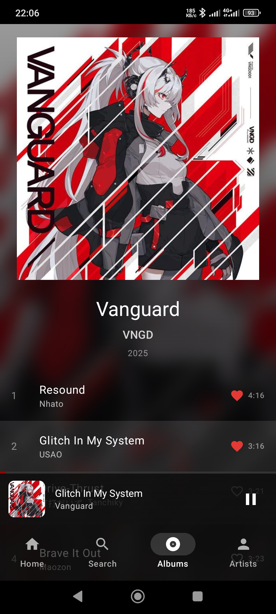
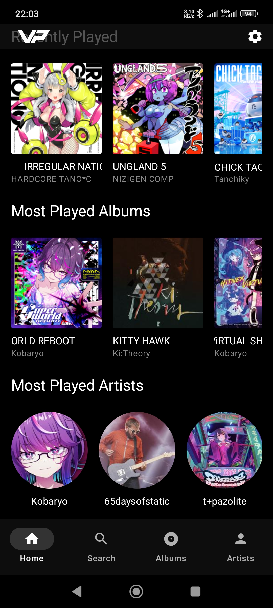
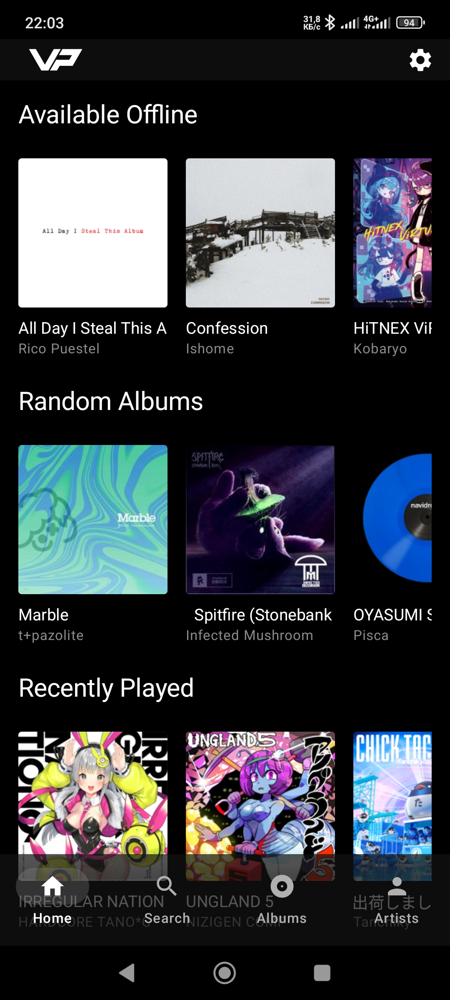
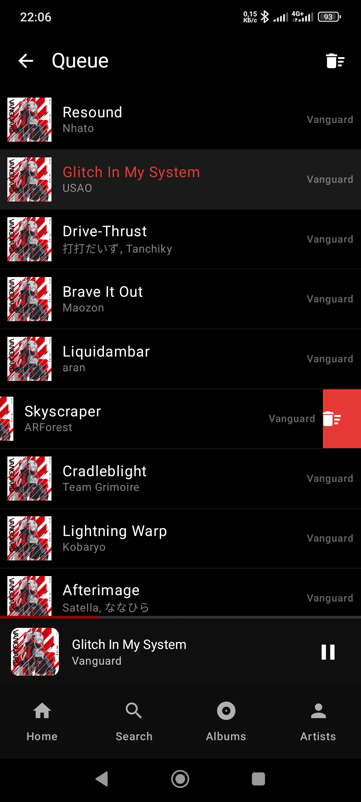
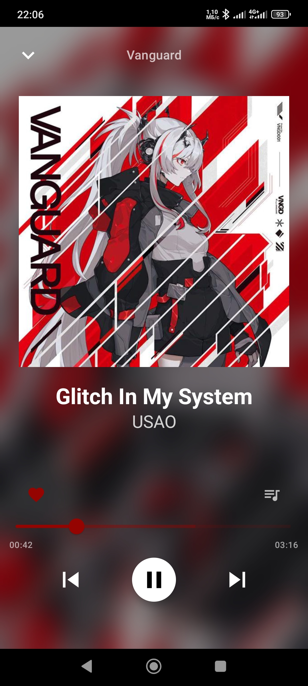
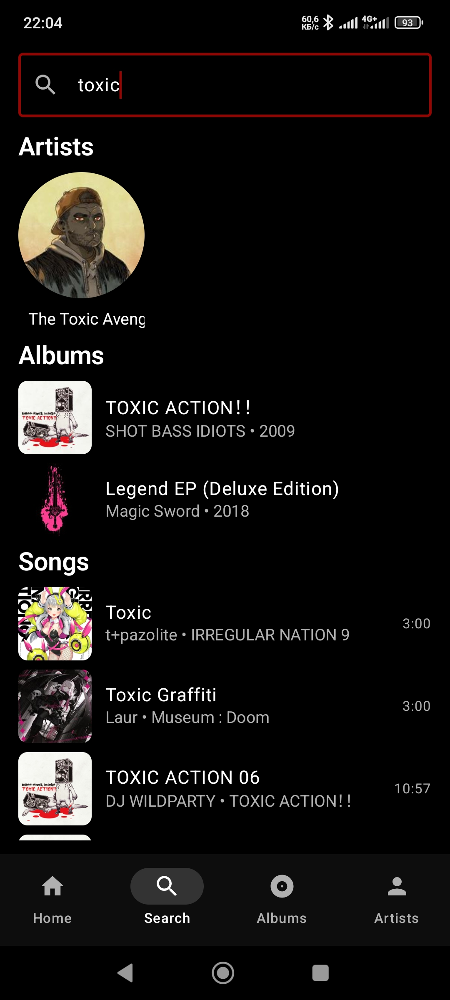
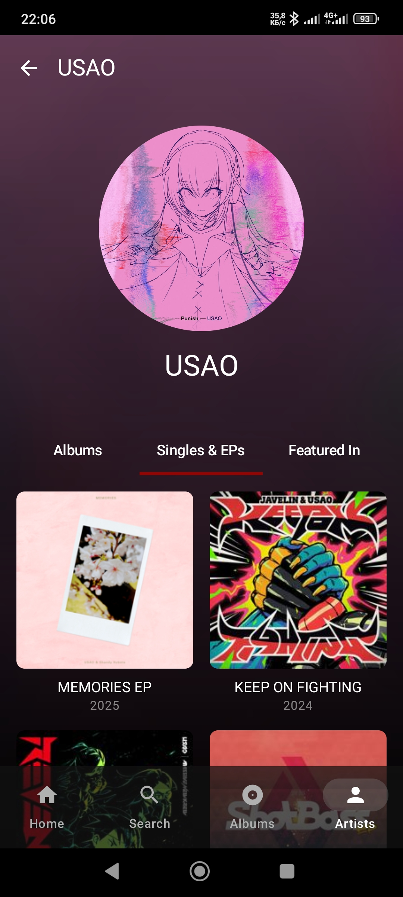
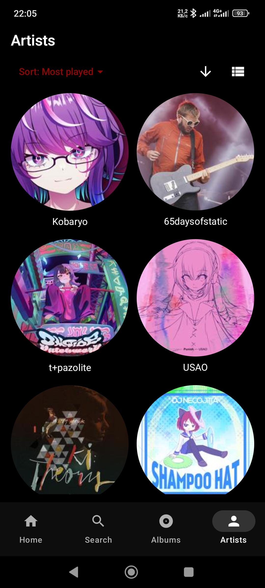
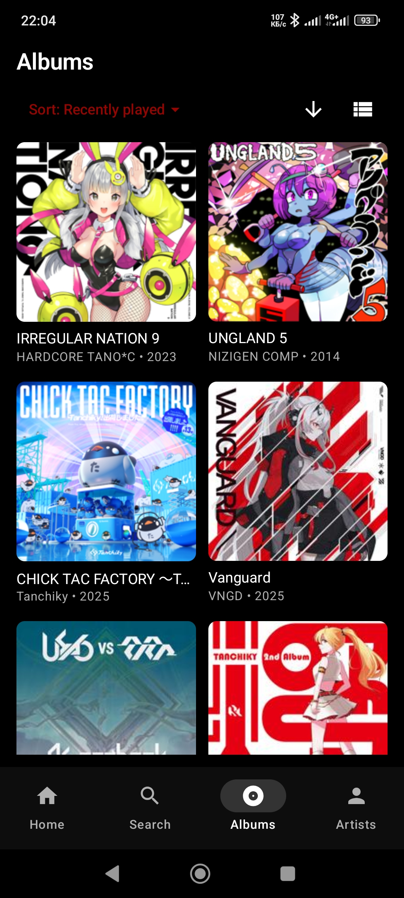

  

# VP [VVAD Player]

**Navidrome music client for Android.** Focused on convenience and speed.

VP is a native Android client for [Navidrome](https://www.navidrome.org/) music servers, built with Jetpack Compose and Media3/ExoPlayer. Designed for fast, offline-first listening with a clean Material 3 interface.

---

## Features

- **Navidrome Integration** — Browse and stream your entire music library
- **Offline-First** — Cache albums for playback without network
- **Background Playback** — Full Media3/ExoPlayer support with notification controls
- **Queue Management** — Album queue actions, explicit remove, drag reorder, and hold-track append
- **Search History** — Recent queries persisted per device with quick reuse and removal

---

## Playback & Queue Controls

### Player Screen
- **Play/Pause, Next/Previous** - Standard transport controls
- **Seek Bar** - Scrub through tracks with haptic feedback
- **Swipe Down** - Close the player
- **Queue Button** - Opens full queue management
- **Song name** - Opens album
- **Artist name** - Opens artist

### Mini Player
- **Tap** - Open the full player
- **Swipe Left/Right** - Skip to next/previous track

### Album Cards
- **Single tap** - Open the album.
- **Double tap** - Play the entire album next.
- **Long press** - Add the entire album to the queue.
- Available on Home, Albums, Artist, Search, and Cached Albums cards.

### Album Screen
- **Download button/checkmark** - Click to download into offline library. Hold to recache or remove.
- **Track entry** - Single tap replaces the queue with the album and plays from that track. Double tap queues the track next. Hold to append it to the current queue.

### Queue Screen
- **Now Playing** — Highlighted and protected from removal
- **Remove button** — Delete any other track
- **Drag handle** — Long-press and drag to reorder, with auto-scroll
- **Clear Queue** — Keep only the current track

### Search
- **Recent searches** — Persisted per device; tap to reuse, remove individual entries, or clear all.

### Settings
- **Categories** - Connection, Transcoding, Image Quality, Cache, and System each open their own submenu.
- **System** - Toggle vibration feedback, choose Light/Medium/Strong intensity, or test the current setting.

---

## Screenshots

| Album | Home | Home |
|:------:|:------:|:---------:|
|  |  |  |

| Queue | Player | Search |
|:-------:|:-----:|:------:|
|  |  |   |

| Artist | Artists | Albums |
|:-----:|:------:|:--------:|
|  |  |  |

---
